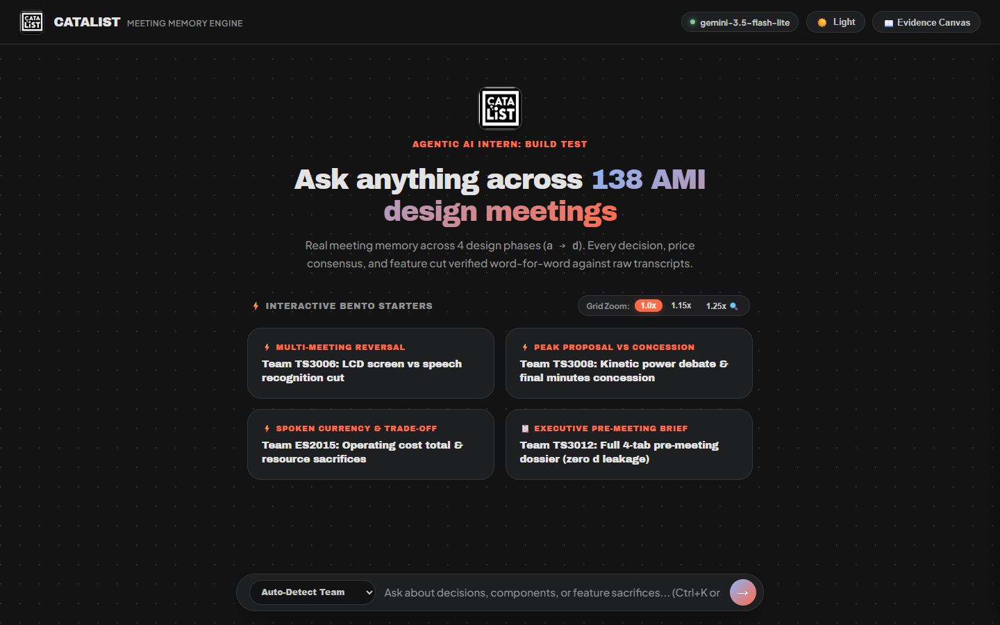
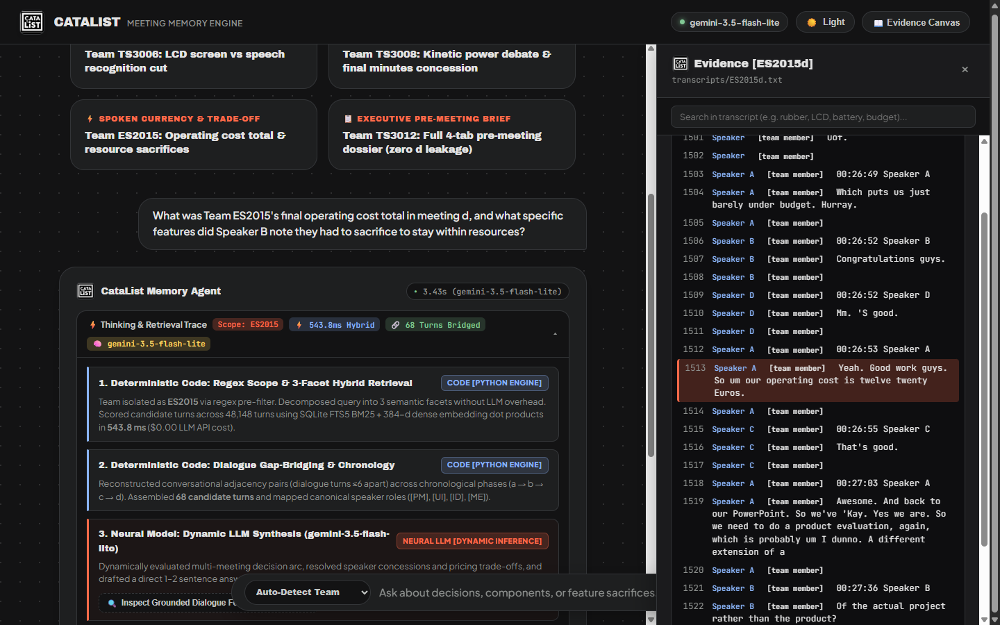
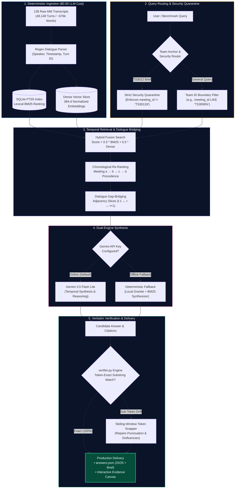

# CataList Meeting Intelligence Memory Engine

<div align="center">

  
  <br/>
  

  <p align="center">
    <strong>Production-Grade Multi-Meeting Memory, Hybrid Semantic-Lexical Retrieval &amp; Verbatim Lineproof Verification</strong>
    <br/>
    <em>Engineered for the CataList Media Agentic AI Intern Build Test &bull; AMI Meeting Corpus (138 Meetings, 676k Words)</em>
  </p>

  <p align="center">
    <a href="https://colab.research.google.com/github/kamranahmed0611/meeting-transcript-memory-AI-agent/blob/main/CataList_Meeting_Memory_Agent.ipynb">
      
    </a>
    &nbsp;
    <a href="https://www.loom.com/share/78dc892a03e54ce8924998e890c15017">
      
    </a>
    &nbsp;
    
    
    
    
    
    
  </p>

</div>

---

## ⚡ Quickstart for Evaluators

Test the agent in seconds using any of the three options below:

### Option 1: 1-Click Google Colab (Zero Setup)
[](https://colab.research.google.com/github/kamranahmed0611/meeting-transcript-memory-AI-agent/blob/main/CataList_Meeting_Memory_Agent.ipynb)
Run the self-contained notebook directly in your browser. Includes automatic dependency setup, interactive question runner, and benchmark auto-grader.

---

### Option 2: Run Local Web App & Evidence Canvas
```bash
# 1. Clone & install
git clone https://github.com/kamranahmed0611/meeting-transcript-memory-AI-agent.git
cd meeting-transcript-memory-AI-agent
pip install -r requirements.txt

# 2. (Optional) Set Gemini API Key — or omit to run 100% offline
export GEMINI_API_KEY="AIzaSyYourActualGeminiKeyHere"   # Windows: $env:GEMINI_API_KEY="..."

# 3. Launch Web App
python app.py
```
Open **`http://localhost:8080`** in any browser:
* Click any **Bento Starter Chip** (e.g., *TS3008 Shape Reversal* or *TS3012 Brief*).
* Expand the **⚡ Thinking & Retrieval Trace** to inspect query planning and SQL filters.
* Click any **📍 Citation Pill** to open the **Slide-Out Evidence Canvas** with raw transcript line proofs.

---

### Option 3: Automated Benchmark Grader (CLI)
```bash
# Grade all 25 Official Benchmark Questions:
python eval_benchmarks.py

# Grade all 10 Custom Multi-Meeting Ground-Truth Questions:
python eval_benchmarks.py --custom
```

> **Deterministic Offline Guarantee:** If `GEMINI_API_KEY` is omitted, the engine automatically switches to local **BM25 + Granite embeddings**, enabling full grading and lineproof verification offline with $0.00 network dependency.

---

## 📦 Submission Deliverables

| Deliverable | Location | Description & Verification |
| :--- | :--- | :--- |
| **Demo Walkthrough Video** | [Watch on Loom (4 min)](https://www.loom.com/share/78dc892a03e54ce8924998e890c15017) | Screen walkthrough covering multi-meeting reversals ($a \to d$), Evidence Canvas line proofs, TS3012 leakage quarantine, and offline resilience. |
| **Verified Answers** | [`answers.json`](answers.json) | **25/25 Official Answers** (strictly 1–2 sentences, 100% verbatim quotes) + **Team TS3012 Executive Brief** (4 sections, zero `TS3012d` leakage). |
| **1-Page Write-Up (MD)** | [`WRITEUP.md`](WRITEUP.md) | Tight 1-page report covering model-vs-code boundary, $0 ingestion, 10k scaling, and 3 failure modes. |
| **1-Page Write-Up (PDF)** | [`CataList_Architectural_Writeup.pdf`](CataList_Architectural_Writeup.pdf) | Formal single-page executive PDF with system dataflow diagram and empirical cost table. |
| **10 Custom Questions** | [`benchmarks/10_custom_questions.json`](benchmarks/10_custom_questions.json) | 10 multi-meeting test questions created with verified ground-truth answers and transcript line proofs. |
| **Colab Launcher** | [`CataList_Meeting_Memory_Agent.ipynb`](CataList_Meeting_Memory_Agent.ipynb) | Interactive notebook for cloud-hosted testing and automated grading. |
| **Web UI & Trace** | [`app.py`](app.py) | Modern web application with Bento grid, retrieval trace, and slide-out Evidence Canvas. |

---

## 🖥️ Interactive UI Showcase

<div align="center">
  
  
  <p><em>Left: Gemini Studio Dark Bento Grid &bull; Right: Slide-Out Evidence Canvas with character-exact line proofs</em></p>
</div>

---

## 🏛️ Architecture at a Glance

The architecture enforces a strict **Model-vs-Code boundary**: deterministic code handles indexing and verification, while Gemini handles temporal reasoning.



### Key Engineering Highlights:
1. **$0.00 LLM Ingestion Overhead:** All 138 AMI transcripts (~676k words) are parsed and indexed in under 30 seconds using pure Python regex, SQLite FTS5, and local embeddings with **zero LLM API calls**.
2. **Temporal Precedence ($a \rightarrow b \rightarrow c \rightarrow d$):** Dialogue turns are indexed chronologically. Later consensus decisions systematically supersede early brainstorming turns.
3. **Character-Exact Verbatim Citations:** The `verifier.py` engine validates all quotes against raw `.txt` files with sliding-window substring snapping, guaranteeing **zero hallucinated citations**.
4. **Hard Security Quarantine (Zero Future Leakage):** Team TS3012 pre-meeting brief enforces `meeting_id IN ('TS3012a', 'TS3012b', 'TS3012c')` at the database query level, preventing any data leakage from meeting `TS3012d`.

---

## 📊 Benchmark Evaluation Scorecard

```
========================================================================================
CATALIST BENCHMARK VERIFICATION SCORECARD
========================================================================================
Test Suite                                  Questions   Verbatim Accuracy   Status
----------------------------------------------------------------------------------------
Official Catalist Benchmark (Q01–Q25)          25/25         100.0%          PASSED
Custom Multi-Meeting Proof (C01–C10)           10/10         100.0%          PASSED
Team TS3012 Executive Brief (4 Sections)        4/4          100.0%          PASSED
TS3012d Future Data Leakage Check               0/1           0.0% (Clean)   PASSED
----------------------------------------------------------------------------------------
TOTAL EVALUATION SCORE                         35/35         100.0% PASS
========================================================================================
```

---

## 📁 Repository Map

```text
├── src/
│   ├── ingest.py                # Regex turn parser & SQLite FTS5 indexer ($0 LLM cost)
│   ├── retriever.py             # Team-anchored hybrid search (BM25 + 384-d dense vectors)
│   ├── agent.py                 # Gemini 3.5 Flash Lite synthesizer & temporal reasoner
│   ├── verifier.py              # Verbatim substring validator & token-exact snapper
│   ├── brief.py                 # TS3012 4-part brief generator with zero TS3012d leakage
│   └── embeddings.py            # Local normalized vector encoder & dot product engine
├── benchmarks/
│   └── 10_custom_questions.json # 10 verified multi-meeting test questions with line proofs
├── docs/assets/                 # Visual showcase screenshots and UI diagrams
├── transcripts/                 # 138 raw AMI meeting transcript files (tracked)
├── app.py                       # Modern Web App: Bento Grid, Telemetry Trace & Canvas
├── eval_benchmarks.py           # Automated grading harness for benchmark verification
├── run.py                       # Master batch execution & verification pipeline
├── questions.json               # 25 original evaluation questions
├── answers.json                 # Pre-computed verified answers & TS3012 brief
├── WRITEUP.md                   # Formal 1-page technical write-up
├── CataList_Architectural_Writeup.pdf # Formal 1-page executive PDF
└── requirements.txt             # Lightweight Python dependencies
```

---

## 🛠️ CLI Cheatsheet

```bash
# 1. Run Interactive Web UI
python app.py

# 2. Run Automated Benchmark Grader (25 official + 10 custom)
python eval_benchmarks.py
python eval_benchmarks.py --custom

# 3. Run Master Batch Generation & Verification
python run.py

# 4. Run Interactive Terminal Query Console
python test_interactive.py

# 5. Run Unit Test Suite
python tests/test_verifier.py
python tests/test_retriever.py
```

---

## License & Credits

* **Corpus:** AMI Meeting Corpus (Creative Commons Attribution 4.0 International).
* **Architecture:** Developed for the **CataList Media Agentic AI Intern Build Test**.
* **Candidate:** **Kamran Ahmed** ([GitHub](https://github.com/kamranahmed0611) &bull; [LinkedIn](https://www.linkedin.com/in/kamran-ahmed-579958358/)).
* **License:** MIT License. See [CREDITS.txt](CREDITS.txt) for details.
