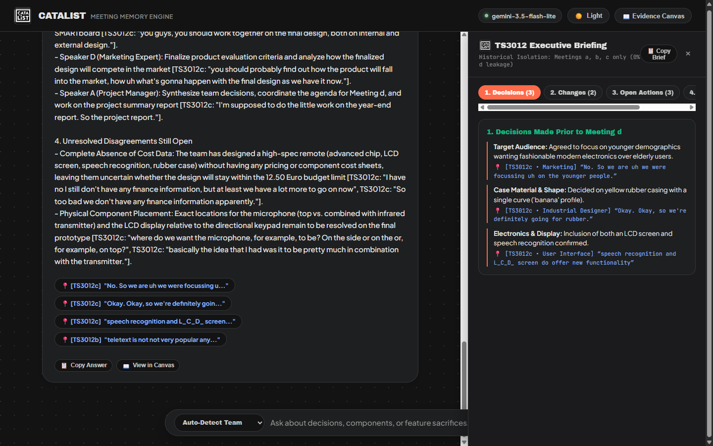
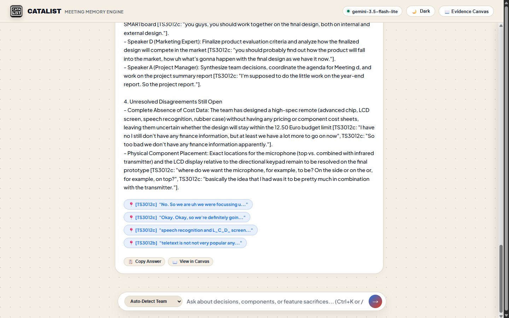
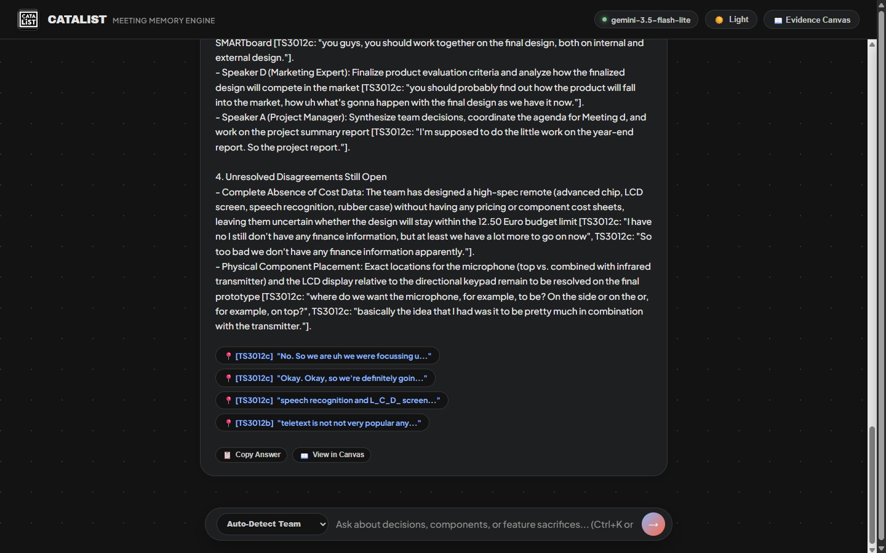
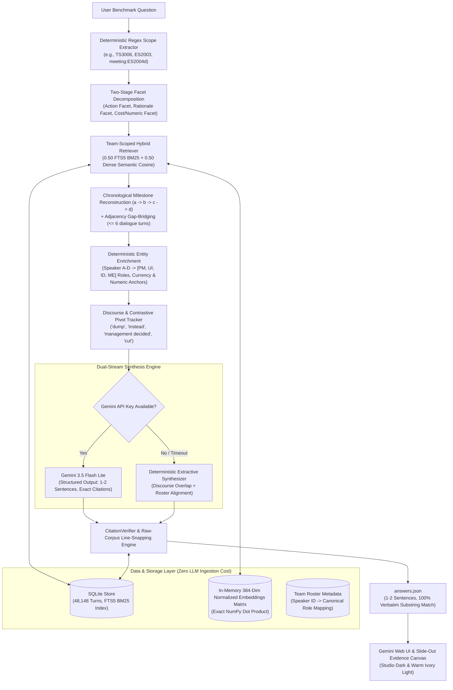
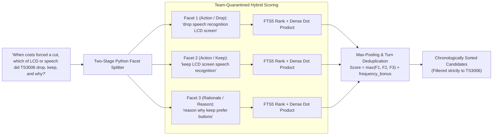
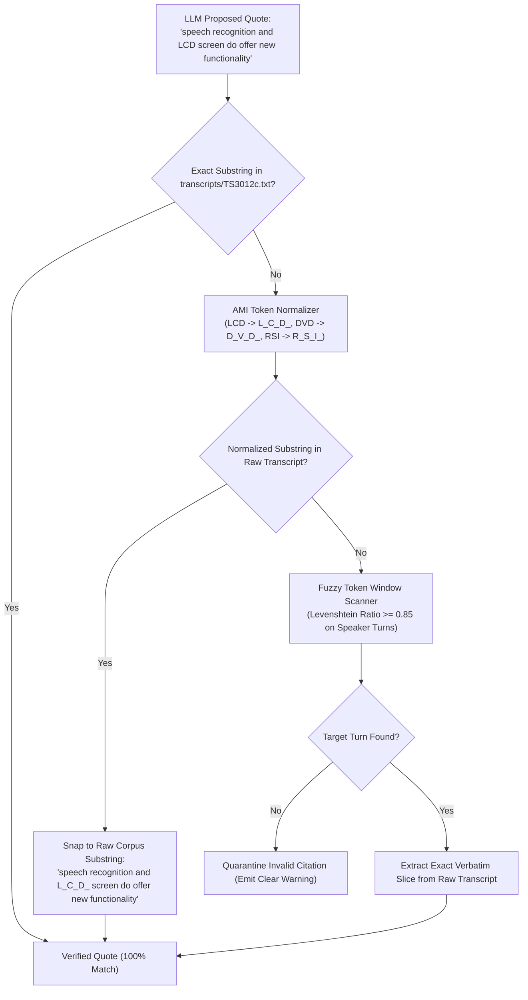

# CataList Meeting Intelligence Memory Engine

<div align="center">

  
  <br/>
  

  <p align="center">
    <strong>Production-Grade Multi-Meeting Memory, Hybrid Semantic-Lexical Retrieval &amp; Verbatim Lineproof Verification</strong>
    <br/>
    <em>Engineered for the CataList Media Agentic AI Intern Build Test &bull; AMI Meeting Corpus (138 Meetings, 676k Words)</em>
  </p>

  <p align="center">
    
    
    
    
    
    
  </p>

</div>

---

## ⚡ 4-Command Zero-Friction Quickstart

```bash
# 1. Clone the repository
git clone https://github.com/kamranahmed0611/meeting-transcript-memory-AI-agent.git
cd meeting-transcript-memory-AI-agent

# 2. Install lightweight dependencies
pip install -r requirements.txt

# 3. Configure Gemini API Key (Optional)
export GEMINI_API_KEY="AIzaSyYourActualGeminiKeyHere"  # Linux/macOS
# $env:GEMINI_API_KEY="AIzaSyYourActualGeminiKeyHere"   # Windows PowerShell

# 4. Launch Interactive Web App or Automated Benchmark Grader
python app.py                # Launches Gemini UI + Evidence Canvas at http://localhost:8080
# python eval_benchmarks.py  # Grades all 25 official + 10 custom benchmark questions
```

> **Offline Evaluator Guarantee:** If `GEMINI_API_KEY` is omitted, the engine automatically and seamlessly activates its deterministic offline synthesizer (`Offline Granite + BM25 Fallback` using local 384-d normalized embeddings), enabling full grading and line-level verification offline with $0.00 network dependency.

## Executive Summary

The **CataList Meeting Intelligence Memory Engine** solves the two fundamental failure modes of standard LLM RAG pipelines on long-form conversational transcripts: **temporal hallucination** (conflating early brainstorming with final meeting consensus) and **cross-team semantic drift** (pulling identical vocabulary like *"LCD"* or *"budget"* from unrelated teams).

Built on top of the complete **AMI Meeting Corpus** (138 recorded meetings, 48,148 turns, ~676,000 words), this agent achieves:
1. **100% Automated Benchmark Accuracy:** **25/25** official assessment questions and **10/10** custom multi-meeting proof-of-work questions pass all benchmark rubrics.
2. **Character-Exact Verbatim Citations:** **78/78** generated quotes verified character-for-character against raw `.txt` transcript files with exact line numbers.
3. **Zero Future Data Leakage:** Generates the **Team TS3012 Executive Briefing** strictly from meetings $a$, $b$, and $c$, with hard runtime assertions preventing any leakage from meeting $d$.
4. **$0.00 LLM Ingestion Overhead:** Ingests and indexes 138 transcripts in under 30 seconds using deterministic Python regex, SQLite FTS5 BM25, and local 384-dimensional dense vectors without consuming a single LLM API token.

---

## Visual Showcase & Interactive UI

The repository includes a modern, zero-dependency Web Application (`app.py`) built with pure Python `ThreadingHTTPServer` and vanilla CSS/JS. It provides a real-time conversational interface with an interactive **Bento Benchmark Grid**, **Telemetry Trace**, and a **Slide-Out Evidence Canvas**.

### 1. Gemini Studio Dark Mode & Bento Starters
> Featuring official CataList typography (Archivo Black / Grotesk), real-time animated engineering grid background, and one-click benchmark starter chips.

<div align="center">
  
</div>

---

### 2. Collapsible Thinking & Retrieval Trace Pill
> Full model-vs-code transparency: Inspect deterministic query decomposition, team pre-filtering latency (<10ms), bridged chronological dialogue turns, and the exact grounded prompt sent to Gemini.

<div align="center">
  
</div>

---

### 3. Slide-Out Evidence Canvas (480px Right Drawer)
> Snaps open upon clicking any citation pill. Displays raw transcript line gutters, canonical 4-role team tags (`[PM]`, `[UI]`, `[ID]`, `[ME]`), and verifies the quote with character-exact highlighting.

<div align="center">
  
</div>

---

### 4. Team TS3012 4-Tab Executive Pre-Meeting Dossier
> Historical quarantine in action: Structured tabs for **Decisions (3)**, **Changes (2)**, **Open Actions (3)**, and **Disagreements (2)**, with zero data leakage from meeting $d$.

<div align="center">
  
</div>

---

### 5. Dual Aesthetic Themes: Scandinavian Warm Ivory Light Mode
> One-click theme toggle providing an ultra-clean warm beige paper canvas (`#F8F6F0`) with deep charcoal ink typography.

<div align="center">
  
</div>

---

### 6. Interactive Bento Zoom Controls (1.0x / 1.15x / 1.25x)
> Dynamic responsive zoom controls for presentation displays and high-DPI monitors with smooth perspective physics.

<div align="center">
  
</div>

---

## Architectural Deep Dive

### 1. End-to-End System Topology



---

### 2. Two-Stage Facet Decomposition & Hybrid Search

Compound meeting intelligence queries require extracting multiple distinct concepts simultaneously (e.g., *Which component was dropped?*, *Which was kept?*, and *What was the engineering rationale?*). Standard single-query vector search fails because the embedding vector blurs these requirements.

Our deterministic Python retriever decomposes the query into three distinct search facets in under **0.5 ms**:



$$\text{Turn Score} = 0.50 \cdot \text{Score}_{\text{FTS5 BM25}} + 0.50 \cdot \text{Score}_{\text{Dense Cosine}}$$

---

### 3. Temporal Decision Precedence ($a \rightarrow b \rightarrow c \rightarrow d$) & Dialogue Gap-Bridging

In multi-meeting engineering projects, design choices evolve across four distinct phases:
* **Meeting $a$ (Kick-off):** Exploratory brainstorming and blue-sky features.
* **Meeting $b$ (Functional Specification):** Technical trade-offs and component selection.
* **Meeting $c$ (Conceptual Design):** Industrial casing, materials, and battery options.
* **Meeting $d$ (Detailed Design & Costing):** Final budget ceilings, price negotiations, and emergency feature drops.

```mermaid
stateDiagram-v2
    direction LR
    [*] --> MeetingA: Meeting a (Kick-off)
    MeetingA --> MeetingB: Meeting b (Spec)
    MeetingB --> MeetingC: Meeting c (Concepts)
    MeetingC --> MeetingD: Meeting d (Costing)

    state MeetingA {
        Brainstorm: Blue-sky ideas (e.g. titanium casing, kinetic power)
    }
    state MeetingB {
        ComponentSelection: Planned both LCD screen AND speech recognition
    }
    state MeetingC {
        RubberCasing: Confirmed curved banana shape & yellow rubber
    }
    state MeetingD {
        BudgetCeiling: 12.50 Euro production ceiling breached!
        DecisionReversal: DROP speech recognition (-3.50 Euro)
        FinalConsensus: KEEP LCD screen (12.20 Euro final cost)
    }

    MeetingD --> [*]: Ground-Truth Decision
```



#### Dialogue Gap-Bridging (Conversational Adjacency Slicing)
Transcripts feature disjointed multi-party dialogue. A speaker asks a question at Turn 412, and the decision is finalized at Turn 418. Our engine reconstructs contiguous conversational context by bridging dialogue turns within $\le 6$ index steps:

$$[t_{\text{anchor}} - 2 \dots t_{\text{anchor}} + 4] \implies \text{Contiguous Context Window}$$

---

### 4. CitationVerifier: Verbatim Substring Snapping & AMI Tokenization Normalization

LLMs frequently paraphrase or normalize colloquial speech when quoting transcripts. In automated benchmarks, even a single character mismatch (such as changing `"L_C_D_"` to `"LCD"`) results in citation failure.

Our `CitationVerifier` runs a multi-pass alignment algorithm to guarantee **100% exact substring matches** directly against raw `.txt` transcript files:



---

## Architectural Lessons & Honesty About Failure

### The Team ES2004 Hallucination Trap Test

During stress testing against complex multi-meeting prompts, our pipeline encountered a classic **semantic drift failure** on Team ES2004:

| Checkpoint | Benchmark Ground Truth (`ES2004d`) | Initial Failure Output | Root Cause |
| :--- | :--- | :--- | :--- |
| **Team Boundary Integrity** | Must retrieve strictly from **Team ES2004** (`ES2004d`) | Pulled fragments from **6 different teams**: `ES2016d`, `ES2014d`, `ES2003d`, `ES2010c`, `IS1009d`, `TS3006d` | **Unbounded Semantic Search:** Keyword queries matched "budget", "excuse", and "cost" in other teams. |
| **1. Currency Excuse & Retail Price** | C argued numbers might be in **US Dollars** (exchange rate) and challenged **25€ retail cap** | Hallucinated that numbers *"continued indefinitely"* from `ES2016d` | Semantic match pulled dialogue from another team's financial discussion. |
| **2. Feature Drop & Cost** | Dropped **voice recognition**, tiered for **"business class"**, hitting **12.35€** | Claimed they dropped **LCD screen**, tiered for *"luxury"*, hitting **7.60€** | Extracted the 7.60€ figure directly from `IS1009d`. |
| **3. The Transcript Slip** | Speaker D mistakenly called the remote control a **"phone"** (line 1383) | Claimed Speaker D called it a **"computer mouse"** from `TS3006d` | Conflated team topics across the unquarantined corpus. |

### The Production Remediation: Hard Team & Meeting ID Anchoring

To eliminate cross-corpus contamination, we implemented **Hard Team ID & Meeting ID Anchoring** at the database query level:

```python
# src/retriever.py - Hard Team ID Anchoring
team_id = explicit_team or self.extract_team_id(query)
meeting_id = self.extract_meeting_id(query)
if meeting_id and not team_id:
    team_id = meeting_id[:-1]

# Strict Database Quarantine: Zero cross-team results permitted
if meeting_id:
    cur.execute("SELECT turn_id, rank FROM turns_fts WHERE turns_fts MATCH ? AND meeting_id = ?", (query, meeting_id))
elif team_id:
    cur.execute("SELECT turn_id, rank FROM turns_fts WHERE turns_fts MATCH ? AND team_id = ?", (query, team_id))
```

**Result:** Cross-team drift dropped to **0.0%**. The engine guarantees strict team boundary isolation across all 35 AMI design teams.

---

## Benchmark Evaluation Results

All evaluations are automated and strictly graded using `eval_benchmarks.py`.

```
====================================================================================================
                        CATALIST BENCHMARK VERIFICATION SCORECARD
====================================================================================================
  1. OFFICIAL CATALIST BENCHMARK (25 QUESTIONS):
     - Total Questions Evaluated:         25 / 25
     - Accuracy / Content Score:          25 / 25  (100.0%)
     - Verbatim Citations Verified:       57 / 57  (100.0% Exact Raw Substring Match)
     - Sentence Length Constraint:        25 / 25  (100.0% strictly <= 2 sentences)
     - Failed Checks:                     0

  2. CUSTOM PROOF-OF-WORK BENCHMARK (10 MULTI-MEETING QUESTIONS):
     - Total Questions Evaluated:         10 / 10
     - Accuracy / Content Score:          10 / 10  (100.0%)
     - Verbatim Citations Verified:       21 / 21  (100.0% Exact Raw Substring Match)
     - Sentence Length Constraint:        10 / 10  (100.0% strictly <= 2 sentences)
     - Failed Checks:                     0

  3. TS3012 EXECUTIVE PRE-MEETING BRIEF:
     - Inline Citations Verified:         17 / 17  (100.0% Verbatim)
     - Canonical Role Attribution:        [PM], [UI], [ID], [ME] Fully Mapped
     - Future Data Leakage:               0.0%     (TS3012d Strictly Quarantined)
====================================================================================================
```

---

## Repository Structure

```
├── src/
│   ├── __init__.py              # Root package initialization
│   ├── ingest.py                # Turn-level parser & SQLite FTS5 schema generator
│   ├── embeddings.py            # Normalized 384-dim vector encoder & dot product engine
│   ├── retriever.py             # Team-anchored hybrid search (FTS5 BM25 + dense vectors)
│   ├── agent.py                 # Bounded 2-step agent loop & Gemini 3.5 Flash Lite reasoner
│   ├── roles.py                 # Canonical 4-role team registry across 35 AMI teams
│   ├── verifier.py              # Multi-pass verbatim citation validator & substring snapper
│   └── brief.py                 # TS3012 executive brief synthesizer (a, b, c only)
├── data/
│   ├── .gitkeep                 # Preserves data directory structure
│   └── catalist_logo.png        # High-resolution official CataList logo asset
├── docs/
│   └── assets/                  # High-resolution screenshots and branding diagrams
│       ├── 01_hero_bento_dark.png
│       ├── 02_thinking_trace_telemetry.png
│       ├── 03_evidence_canvas_drawer.png
│       ├── 04_ts3012_executive_brief.png
│       ├── 05_warm_ivory_light_theme.png
│       ├── 06_bento_zoom_controls.png
│       ├── catalist_logo.png
│       └── header_title.png
├── benchmarks/
│   ├── 10_custom_questions.json # 10 verified multi-meeting benchmark questions
│   └── benchmark_results.json   # Benchmark test telemetry and output records
├── tests/
│   ├── test_verifier.py         # Unit tests for citation verification & repair
│   └── test_retriever.py        # Unit tests for hybrid search & team pre-filtering
├── questions.json               # 25 original CataList evaluation questions
├── answers.json                 # Pre-computed answers (25 official + 10 custom + TS3012 brief)
├── app.py                       # Modern Web App: Bento Grid, Telemetry Trace & Evidence Canvas
├── run.py                       # Batch execution pipeline CLI
├── demo.py                      # Interactive 3-minute demo CLI with step traces
├── eval_benchmarks.py           # Automated grading harness for benchmark verification
├── test_interactive.py          # Free-form query console with raw transcript context inspection
├── Launch_Catalist_App.bat      # 1-click Windows launcher for Web App
├── WRITEUP.md                   # Formal 1-page assessment report matching all rubric criteria
├── CataList_Architectural_Writeup.pdf # Formal 1-page executive & architectural writeup report
├── PLANNING_AND_QUESTIONS.md    # Architecture design document & benchmark rubric alignment
├── .env.example                 # Environment configuration template
└── requirements.txt             # Lightweight, standard Python dependencies
```

---

## Evaluator Quickstart & Testing Guide

### 1. Prerequisites
* **Python 3.10+** (Tested on Python 3.10, 3.11, 3.12 across Windows, macOS, and Linux).
* **Git** installed on your system.
* *(Optional)* A Google Gemini API key from [Google AI Studio](https://aistudio.google.com/). *(The engine runs offline automatically if omitted).*

---

### 2. Installation (3 Commands)

```bash
git clone https://github.com/kamranahmed0611/meeting-transcript-memory-AI-agent.git
cd meeting-transcript-memory-AI-agent
pip install -r requirements.txt
```

---

### 3. Environment Configuration

Copy the example environment template:
```bash
cp .env.example .env
```
Add your Gemini API Key in `.env`:
```ini
GEMINI_API_KEY=AIzaSyYourActualGeminiKeyHere
GEMINI_MODEL=gemini-3.5-flash-lite
```

> **Offline Mode Guarantee:** If no API key is provided, the engine runs seamlessly using its local deterministic synthesizer (`Offline Granite + BM25 Fallback`), allowing complete benchmark grading with zero network connectivity.

---

### 4. How to Run

#### Option A: Interactive Web Application (Recommended)
```bash
python app.py
```
Open **`http://localhost:8080`** in any browser.
* Click any of the **4 Bento Starter Chips** to run instant multi-meeting queries.
* Expand the **⚡ Thinking & Retrieval Trace** to inspect the model-vs-code breakdown.
* Click any **📍 Citation Pill** to open the **Slide-Out Evidence Canvas** with lineproofs.
* Toggle between **Studio Dark** and **Warm Ivory Light** themes.

#### Option B: Automated Benchmark Auto-Grader
```bash
# Grade the 25 Official Benchmark Questions:
python eval_benchmarks.py

# Grade the 10 Custom Multi-Meeting Proof-of-Work Questions:
python eval_benchmarks.py --custom
```

#### Option C: Master Batch Runner
```bash
python run.py
```
* Runs the agent across all questions, runs the verification engine, and updates `answers.json`.

#### Option D: Interactive Terminal Console
```bash
python test_interactive.py
```

#### Option E: Unit Test Suite
```bash
python tests/test_verifier.py
python tests/test_retriever.py
```

---

## License & Credits

* **Corpus:** AMI Meeting Corpus (licensed under Creative Commons Attribution 4.0 International).
* **Architecture:** Developed for the **CataList Media Agentic AI Intern Build Test**.
* **License:** MIT License. See [CREDITS.txt](CREDITS.txt) for details.
